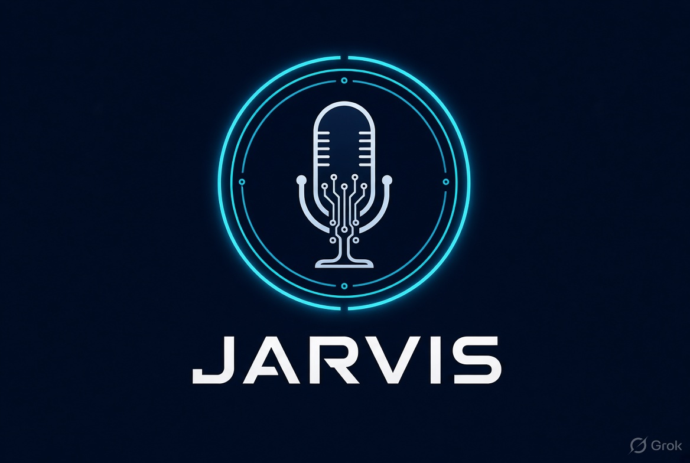

<p align="center">
  
</p>

<h1 align="center">Jarvis Voice Assistant</h1>

<p align="center">
  A modular AI assistant for voice, research, freelancing workflows, and safe offline development.
</p>

<p align="center">
  
  
</p>

---

## Desktop look

<p align="center">
  
</p>

## What it is


Jarvis started as a single voice script and is now a package you can extend.

- Voice loop with optional neural TTS
- Memory, skills, and a multi-agent orchestrator
- Resource finder and download manager
- Offline development engine with a workspace jail
- Freelancer drafts, scoring, and approval gates
- Optional Agent Reach research adapter
- Hermes-inspired context files, checkpoints, and skill approval

External actions stay behind an approval gate. Generated-code execution stays blocked until a real isolated runner is verified.

## Layout

```text
jarvis/
  app/            voice and UI entry
  ai/             provider router and research
  memory/         persistent memory
  skills/         skill registry and learning
  core/           orchestrator and agents
  resources/      finder and downloads
  dev/            offline development engine
  freelancer/     jobs, proposals, finance
  integrations/   Agent Reach adapter
  adapt/          context, checkpoints, MCP registry
  tests/          pytest suite
run_jarvis.py     launcher
```

## Quick start

```bash
python -m venv .venv
source .venv/bin/activate
pip install -r requirements.txt
python run_jarvis.py
```

Voice packages are optional. If the microphone or TTS library is missing, Jarvis falls back to text.

### Neural voice

Free Edge neural voice needs no API key:

```bash
pip install edge-tts
```

Set `edge_voice` in `jarvis_config.json`. ElevenLabs is optional and only used if `ELEVENLABS_API_KEY` is set.

## Configuration

Copy `jarvis_config.json` and edit names, wake word, and voice. Do not commit API keys.

| Setting | Purpose |
|---------|---------|
| `assistant_name` | Spoken name |
| `wake_word` | Voice trigger |
| `edge_voice` | Free neural voice id |
| `tts_provider` | `edge` or `elevenlabs` |

## Safety

- No hardcoded credentials
- External submits need explicit approval
- Retrieved web content is untrusted data
- Private and loopback URLs are rejected
- Phase 6F isolated execution remains blocked

## Tests

```bash
PYTHONPATH=. python -m pytest -q
```

## License

Personal project by Debashis Paul. Use and modify for your own work.
