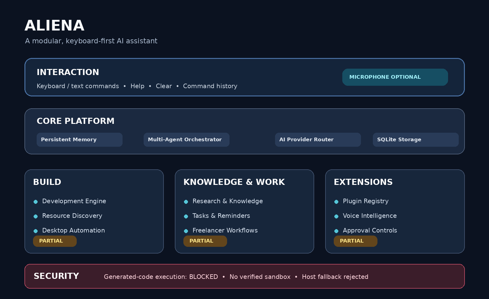

<p align="center">
  
</p>

<p align="center"><strong>Keyboard-First · Modular · Voice Optional</strong></p>

<p align="center">
  
  
  
</p>

## System overview

<p align="center">
  
</p>

## Features

| Module | Capability | Status |
|---|---|---|
| Core | Persistent memory, multi-agent orchestration, SQLite | **Complete** |
| AI Router | Provider routing and fallback structure | **Complete — mocked/offline** |
| Development | Planning, controlled file writing, validation | **Partial** |
| Resources | Discovery and download manager | **Partial** |
| Interaction | Keyboard commands, help, clear, basic history | **Partial** |
| Voice | Voice state and settings | **Partial** |
| Automation | Desktop permission and adapter layers | **Partial** |
| Research & Productivity | Knowledge store, tasks, projects, reminders | **Partial** |
| Plugins & Freelancer | Registry, drafts and approval workflows | **Partial** |

## Interface preview

<p align="center">
  
</p>
<p align="center"><sub>Concept preview only; not proof of operational functionality.</sub></p>

## Run locally

```bash
python -m venv .venv

# Windows
.venv\Scripts\activate

# macOS / Linux
source .venv/bin/activate

python -m pip install --upgrade pip
pip install -r requirements.txt
python run_jarvis.py
```

Run tests:

```bash
PYTHONPATH=. python -m pytest -q
```

## Safety & current limits

- Keyboard/text mode does not require a microphone.
- Live Gemini, live research fetching, real desktop drivers and notification delivery are not verified.
- Plugins are not automatically executed.
- **Generated-code execution is BLOCKED:** no verified isolated execution provider is available; host fallback is rejected.
- **Production status: NOT READY.**

See [`ROADMAP.md`](ROADMAP.md) · [`IMPLEMENTATION_STATUS.md`](IMPLEMENTATION_STATUS.md) · [`KEYBOARD-STATUS.md`](KEYBOARD-STATUS.md) · [`MISSION4-SECURITY.md`](MISSION4-SECURITY.md)

<p align="center"><sub>Development build — feature status is not a production-readiness claim.</sub></p>
