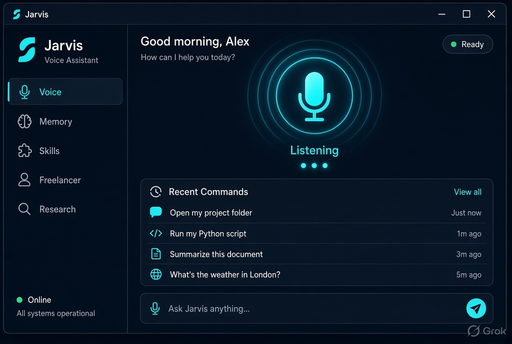
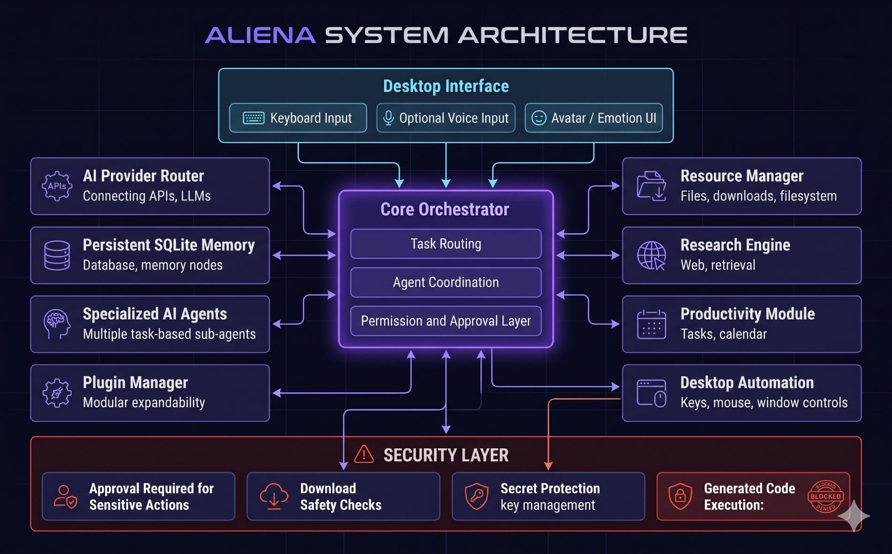
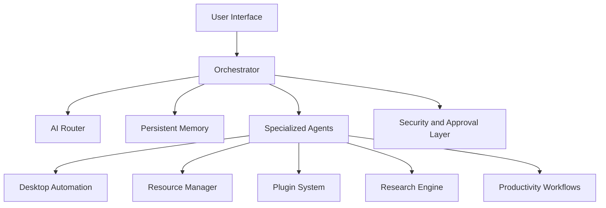

# ⚡ ALIENA

Your Personal AI Desktop Assistant

<p align="center">
  
</p>

<p align="center">
  <b>A modular, keyboard-first AI desktop assistant with persistent memory, multi-agent orchestration and desktop automation.</b>
</p>

<p align="center">
  
  
  
  
</p>

---

## Desktop Experience

<p align="center">
  
</p>

Aliena is designed to become a personal desktop AI environment that combines memory, intelligent task orchestration, automation and productivity in one modular application.

## Core Features

| Feature | Description |
|---------|-------------|
| Persistent Memory | SQLite-backed memory system |
| Multi-Agent System | Modular agent orchestration |
| AI Router | Provider routing with offline/mock support |
| Emotion Interface | 20 visual avatar expressions |
| Keyboard First | Operate without a microphone |
| Desktop Automation | Permission-controlled desktop actions |
| Resource Manager | Resource discovery and download workflows |
| Plugin Architecture | Modular plugin registration and approval |
| Research Engine | Research workflow components |
| Productivity | Task and productivity features |
| Freelancer Tools | Draft-based workflows with approval gates |
| Security Controls | Approval boundaries and fail-closed execution |

## Aliena Emotion System

<p align="center">
  
  
  
  
</p>

<p align="center"><i>Normal · Happy · Excited · Thinking</i></p>

<details>
<summary><b>View all 20 expressions</b></summary>

| Expression | Preview | Expression | Preview |
|------------|---------|------------|---------|
| Normal | `assets/aliena/emotions/normal.png` | Happy | `assets/aliena/emotions/happy.png` |
| Laugh | `assets/aliena/emotions/laugh.png` | Sad | `assets/aliena/emotions/sad.png` |
| Angry | `assets/aliena/emotions/angry.png` | Thinking | `assets/aliena/emotions/thinking.png` |
| Surprised | `assets/aliena/emotions/surprised.png` | Shy | `assets/aliena/emotions/shy.png` |
| Sleepy | `assets/aliena/emotions/sleepy.png` | Excited | `assets/aliena/emotions/excited.png` |
| Confused | `assets/aliena/emotions/confused.png` | Embarrassed | `assets/aliena/emotions/embarrassed.png` |
| Pouting | `assets/aliena/emotions/pouting.png` | Wink | `assets/aliena/emotions/wink.png` |
| Cute | `assets/aliena/emotions/cute.png` | Calm | `assets/aliena/emotions/calm.png` |
| Talking | `assets/aliena/emotions/talking.png` | Pondering | `assets/aliena/emotions/pondering.png` |
| Joyful | `assets/aliena/emotions/joyful.png` | Shocked | `assets/aliena/emotions/shocked.png` |

</details>

## Architecture

<p align="center">
  
</p>

<p align="center">
  
</p>



## Installation

Requirements:

- Windows 10 or compatible environment
- Python 3.10+
- Git
- Microphone: Optional

```bash
git clone https://github.com/debashispaul2023-svg/Jarvis-Voice-Assistant.git
cd Jarvis-Voice-Assistant
python -m venv .venv
```

Windows CMD:

```bat
.venv\Scripts\activate
```

PowerShell:

```powershell
.\.venv\Scripts\Activate.ps1
```

```bash
python -m pip install --upgrade pip
pip install -r requirements.txt
python run_jarvis.py
```

Follow the configuration instructions in the project documentation. Some optional integrations may require additional setup.

## Security First

- Sensitive desktop operations require confirmation.
- Plugin actions use approval boundaries.
- Secrets should be provided through environment variables.
- Generated-code execution remains blocked until genuine isolation is verified.
- Downloaded resources must not execute automatically.

## Development Status

| Component | Status |
|-----------|--------|
| Core Architecture | Implemented |
| Persistent Memory | Implemented |
| Multi-Agent Orchestration | Implemented |
| Emotion UI | Implemented |
| Keyboard Interaction | Implemented |
| AI Provider Integration | Partial / Live verification pending |
| Desktop Automation | Partial |
| Resource Manager | Partial |
| Research Engine | Partial |
| Productivity Workflows | Partial |
| Plugin System | Partial |
| Freelancer Workflows | Partial |
| Generated-Code Execution | Blocked |
| Phase 6F Isolation | Blocked |

Implemented does not mean production-verified. Live provider integrations and environment-dependent features require separate verification.

## Documentation

- Implementation Status (`IMPLEMENTATION_STATUS.md`)
- Development Roadmap (`ROADMAP.md`)
- Known Limitations (`KNOWN_LIMITATIONS.md`)
- Security Documentation (`SECURITY.md`)
- Keyboard Status (`docs/development/KEYBOARD-STATUS.md`)

## Roadmap

- [x] Modular assistant architecture
- [x] Persistent memory foundation
- [x] Multi-agent orchestration foundation
- [x] Emotion interface foundation
- [ ] Complete security verification
- [ ] Genuine execution isolation
- [ ] Complete desktop automation verification
- [ ] Live AI provider verification
- [ ] Complete remaining integrations

## Project

Created by: Debashis Paul

Repository: [Aliena — Voice Assistant](https://github.com/debashispaul2023-svg/Jarvis-Voice-Assistant)

---

<p align="center">
  <b>ALIENA</b><br/>
  <i>Intelligence. Memory. Automation.</i>
</p>

<p align="center">Independent development project · Work in progress</p>
